<div align="center">

# spritefx

**Pixel-art VFX from a JSON spec.**
Explosions, slashes, smoke, fire, water and magic as palette-locked sprite sheets, ready for your engine. Every frame is simulated, quantized and audited against the rules pixel artists use.

[](https://github.com/HoangLong256/spritefx/actions/workflows/tests.yml)


**[Use with Claude Code](#-use-it-with-claude-code)** · [Gallery](#gallery) · [Demo](#demo-the-witch-summons-a-devil-and-gets-a-bunny) · [Quick start (CLI)](#quick-start)

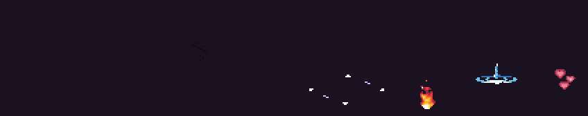

<sub>Every pixel above came from a JSON file. Nothing was painted or touched up by hand.</sub>

</div>

---

Procedural effects usually look procedural: soft alpha gradients, noisy blobs, a hundred colours, a glow that smears into everything. Hand-drawn pixel VFX look different. They have a dark contrast frame, a one-frame white flash, a hot core with a cool rim, and smoke that erodes into crescents and dots instead of fading out.

**spritefx encodes that craft.** You describe an effect as layers on a timeline. The engine simulates it tick by tick, maps every value to a step of a palette ramp, composites in *palette space*, cleans up stray pixels, and then **audits the result**. It fails the build if the flash comes after the peak, the smoke ends before the fire, edges blink A-B-A, or the effect can't be read on a light background.

- 🎨 **Palette-locked.** Every pixel is a palette colour, alpha is 0 or 255, and there's an indexed PNG for palette swaps.
- 🧪 **Real simulations underneath.** Particles, SDF shapes, loopable noise, Doom fire, grid smoke (stable fluids + MacCormack) and FLIP water, all reduced to clean pixel clusters.
- 🔍 **22 craft checks.** Envelope, flash order, flicker, orphans, speckle, loop seams, readability on dark/mid/light ground, a WCAG flash-rate warning and more.
- 🎮 **Engine-ready.** Uniform strip, Aseprite-style JSON with per-frame durations, phase tags, gameplay events (`hit`, `shake:3`) and the anchor point, plus additive and emissive layers for glow.
- 🔁 **Deterministic.** The same spec always gives byte-identical PNGs, so a spec diffs and reviews like any other code.
- 🤖 **Agent-native.** It ships as a [Claude Code](https://claude.com/claude-code) skill: [install it with one command](#-use-it-with-claude-code), ask for *"a frost nova, 48 px, one-shot"*, and Claude writes the spec while the scripts do the drawing.

## ✨ Use it with Claude Code

spritefx is a [Claude Code skill](https://docs.claude.com/en/docs/claude-code/skills). Install it once, then describe the effect you want in plain words.

**1. Install** (one command):

```bash
git clone https://github.com/HoangLong256/spritefx ~/.claude/skills/spritefx
```

**2. Ask Claude Code for an effect**, in any project:

```text
> Make a 32 px poison cloud that lingers
> A slash, hit and trail set for my greatsword
> A blue portal: opening, idle loop and closing
> Give my healing potion a sparkle effect, 48 px
```

That's all. On first use Claude sets up the skill's Python environment (Python 3.11+ is the only requirement). Then for every effect it:

1. **sizes it** and tells you the pixel size, length and time estimate;
2. **starts from the closest example** and writes the JSON spec in your project;
3. **builds it**, reads the review sheets and fixes every audit fault **in the spec, never in the pixels**;
4. hands you **game-ready sheets** in `out/fx/<name>/sheets/`, plus a GIF to watch.

It can also run a **blind read**, where fresh reviewers score your effect next to hand-drawn references. The full playbook is in [`SKILL.md`](SKILL.md).

<details>
<summary>Install for one project only, or set up the venv yourself</summary>

```bash
# just this project: the skill lives in .claude/skills/ next to your code
git clone https://github.com/HoangLong256/spritefx .claude/skills/spritefx

# set up the venv now instead of on first use
cd ~/.claude/skills/spritefx && python3.11 -m venv .venv && .venv/bin/pip install -e .

# update later
git -C ~/.claude/skills/spritefx pull
```

</details>

## Gallery

<table>
<tr>
<td align="center"><br><code>explosion</code></td>
<td align="center">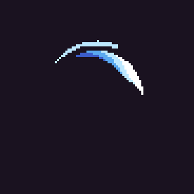<br><code>slash</code></td>
<td align="center">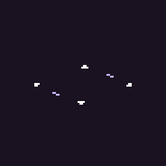<br><code>summon</code> · start / loop / end</td>
</tr>
<tr>
<td align="center"><br><code>demon_burst</code></td>
<td align="center">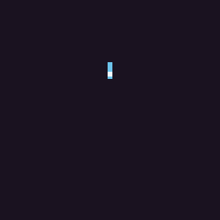<br><code>water_splash</code></td>
<td align="center"><br><code>hearts</code> · <code>heart</code> SDF</td>
</tr>
<tr>
<td align="center">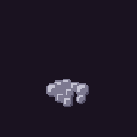<br><code>smoke_burst</code> · grid smoke sim</td>
<td align="center">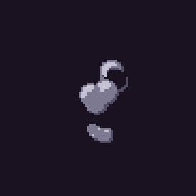<br><code>smoke_plume</code> · grid smoke, loop</td>
<td align="center">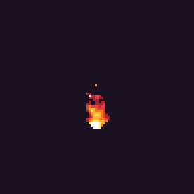<br><code>campfire</code> · noise flame, loop</td>
</tr>
<tr>
<td align="center">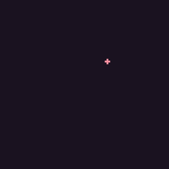<br><code>heal_potion</code></td>
<td align="center">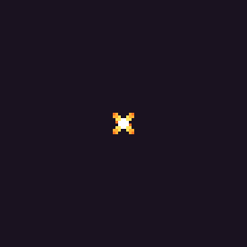<br><code>hit_spark</code></td>
<td align="center">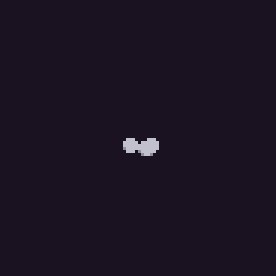<br><code>smoke_puff</code></td>
</tr>
</table>

<sub>Shown at 3×; the real sprites are 26–90 px. Every spec is in <a href="examples/"><code>examples/</code></a>.</sub>

## Demo: the witch summons a devil… and gets a bunny

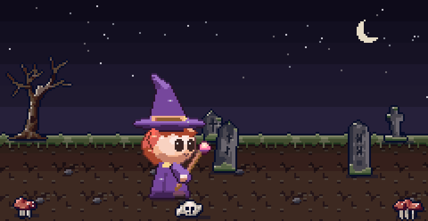

A 12-second scene built only from generated sheets. All the effects come from spritefx: the demonic circle, the staff charge, the dark smoke column, the burst, the pink reveal pop and the hearts. The characters and tiles come from a companion sprite tool. A small script places and times everything on a 30 fps clock and adds the scene light and camera shake. Nothing was painted by hand. The scene's effect specs are in [`examples/witch_summon/`](examples/witch_summon/).

## Quick start

Without Claude, you write the spec and run the CLI yourself:

```bash
git clone https://github.com/HoangLong256/spritefx && cd spritefx
python3.11 -m venv .venv && .venv/bin/pip install -e ".[test]"

.venv/bin/python -m fx build examples/explosion.json --out out
open out/explosion/review/explosion.gif      # the effect at real timing
ls out/explosion/sheets/                     # the game-ready files
```

No GPU, no game engine, and only three dependencies (numpy, Pillow, jsonschema).

## What a spec looks like

A complete hit spark: a 4-point star that flares and then erodes, plus radial streaks.

```json
{
  "name": "hit_spark", "type": "hit", "canvas": "auto", "anchor": "center", "fps": 30, "seed": 3,
  "ramps": {"spark": {"colors": ["#9e2835", "#f77622", "#feae34", "#fee761", "#ffffff"]}},
  "phases": [
    {"name": "flash", "ticks": 2, "fast": true, "events": ["hit"]},
    {"name": "burst", "ticks": 3},
    {"name": "fade", "ticks": 5}
  ],
  "layers": [
    {"id": "star", "kind": "shape", "ramp": "spark",
     "shape": {"sdf": "star", "points": 4, "r": {"keys": [[0, 7], [0.2, 9], [1, 3]], "ease": "out"}, "inner": 0.3},
     "value_mode": "radial", "edge": 0.0, "break_up": {"after": 0.45, "noise": "angular"}},
    {"id": "streaks", "kind": "particles", "ramp": "spark", "tag": "debris",
     "emit": {"mode": "burst", "count": [6, 7]}, "velocity": {"speed": [1.6, 2.6], "angle": "out"},
     "drag": 0.18, "life": [6, 9], "stamp": {"kind": "streak", "size": {"keys": [[0, 3], [1, 1]]}}}
  ]
}
```

Phases run on a 30 fps tick clock. Parameters can be keyed and eased over a layer's life. Each layer maps its value onto a ramp, dark to light, so **you pick the ramp and the curve, never a colour per pixel**. Every field is documented in [`references/spec.md`](references/spec.md).

## How it works

```
spec.json ─▶ simulate layers ─▶ value → ramp step ─▶ composite in ─▶ cleanup ─▶ audit ─▶ sheets
             tick by tick       (with hysteresis)    palette space    clusters   22 checks
```

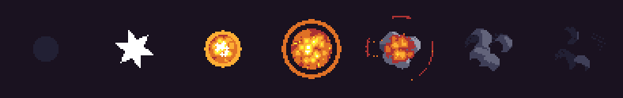

The explosion above follows the classic phase model: **contrast → flash → peak → decay → linger**. The audits check that structure numerically. Every build writes an envelope sheet showing coverage, lightness and pixels per colour over time, with phases shaded and events marked:

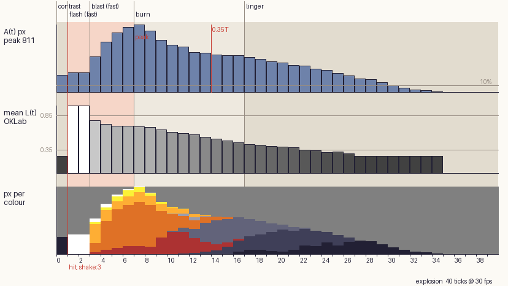

A fast rise, a slow decay, smoke outlasting fire and a clean last frame are all enforced, not hoped for. See [`references/verify.md`](references/verify.md) for every check, its limit and how to fix it in the spec.

## Layer kinds

| Kind | For |
|---|---|
| `shape` | SDF shapes (circle, ring, arc, crescent, moon, star, rays, heart, ripple, polygon, capsule, beam) with keyed parameters and noise erosion (`break_up`) |
| `particles` | Bursts and streams: dot, plus, diamond, disc, star, streak and eroding `puff` stamps; gravity, drag, wind, wiggle, ground bounce; exact analytic loops |
| `field` | Loopable noise (value, perlin, worley, fbm, domain warp) and polar fields under an SDF mask; flame mode |
| `trail` | The swept area of another layer over its last ticks: smears and projectile trails |
| `bolt` | Lightning: midpoint displacement, branches, reseeding, blank frames |
| `cycle` | Palette cycling over a field: portals, beams, shimmer |
| `doom` | Doom-style cellular fire with a seamless crossfade loop |
| `smoke` | Grid smoke: stable fluids with MacCormack advection, vorticity and buoyancy, thresholded into clean billows |
| `stream` | Ballistic water streams drawn as tapering, side-lit curves with beads that fall off as drops |
| `water` | FLIP liquid drawn as hard-edged pixel metaballs with spray |

## Outputs

`fx build` writes the sheets only when the audit reports zero faults:

```
out/<name>/sheets/
  <name>.png            one-row strip, uniform cells, palette-locked
  <name>.json           Aseprite-style: frame durations, phase/section tags, events, anchor
  <name>_base.png       frames without the additive layers ┐ draw _base normally,
  <name>_add.png        the additive layers alone          ┘ then _add with additive blend
  <name>_emissive.png   the hot core, for bloom or lights
  <name>_indexed.png    8-bit palette PNG for palette swaps
out/<name>/review/      color, layers, motion, closeup (8×), backgrounds, curve, GIF
```

Wiring for Godot, Unity and GameMaker (flipbooks, one-shot vs loop tags, anchors, events, additive blending) is in [`references/spec.md`](references/spec.md#using-the-sheet-in-a-game).

## CLI

```
python -m fx doctor        [--out DIR]          check Python, pinned packages, writable --out
python -m fx validate      <spec>               schema and reference checks only
python -m fx render        <spec> [--out DIR]   frames, buffers, review sheets
python -m fx audit         <spec> [--out DIR]   the checks on the last render
python -m fx build         <spec> [--out DIR]   validate → render → audit → sheets; exit 1 on any fault
python -m fx gif           <spec> [--out DIR]   the review GIF at real timing
python -m fx palette-check <palette>
```

## Project layout

```
fx/            the package: spec, timeline, layer engines (fx/layers/), compositor, cleanup, audits, sheets
examples/      13 effect specs plus the demo scene's 5 (witch_summon/), all building with 0 faults
references/    spec.md (every field), craft.md (the art rules), verify.md (every check)
docs/          ARCHITECTURE.md (module contract) and the README media
scripts/       showcase.py rebuilds the README GIFs from built examples
tests/         300+ tests: `.venv/bin/python -m pytest -q`
```

## Contributing

New effects are the best contribution. Add a spec to `examples/` that builds with zero faults, then regenerate the showcase:

```bash
for f in examples/*.json; do .venv/bin/python -m fx build "$f" --out out; done
.venv/bin/python scripts/showcase.py
```

New layer kinds, checks and calibration data are welcome too. Read [`docs/ARCHITECTURE.md`](docs/ARCHITECTURE.md) first. Keep everything deterministic, and fix a failing check in the spec rather than loosening its limit.

## Credits

- FLIP solver ported from Matthias Müller's [Ten Minute Physics](https://github.com/matthias-research/pages) #18 (MIT).
- Doom fire after Fabien Sanglard's write-up of the PSX Doom fire; stable fluids after Jos Stam; vorticity confinement after Fedkiw et al.
- Some particle ideas follow [Pixel Composer](https://github.com/Ttanasart-pt/Pixel-Composer) (MIT).
- The craft rules and check calibration lean on hand-drawn effects by pixel artists such as Saint11. No third-party art is included.

## License

[MIT](LICENSE) © 2026 Long Nguyen
